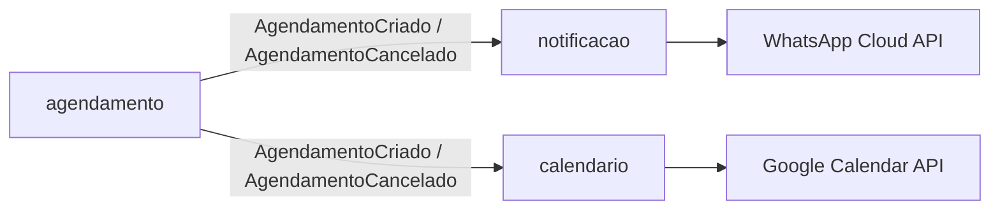

# BYG Barbearia — Sistema de agendamento

Sistema web de agendamento online para a **BYG Barbearia**. O cliente escolhe o serviço, o barbeiro e o horário pelo site; o horário aparece no Google Agenda do barbeiro e o cliente recebe confirmação e lembrete pelo WhatsApp.

> **Status:** em desenvolvimento (v1).

## Funcionalidades

**v1**
- Agendamento em três passos: serviço → barbeiro → horário
- Bloqueio de conflito de horário, garantido também por constraint no banco
- Painel do barbeiro com a agenda do dia
- Sincronização com o Google Agenda do barbeiro (criar, atualizar e cancelar eventos)
- Login único para cliente e barbeiro, por e-mail ou telefone, com opção "Continuar com Google" e agendamento sem cadastro

**v2**
- Confirmação e lembrete automáticos pelo WhatsApp (Cloud API oficial da Meta)

## Stack

| Camada | Tecnologia |
|---|---|
| Back-end | Java 25, Spring Boot 4, Spring Modulith, Spring Data JPA, Spring Security |
| Front-end | Angular |
| Banco de dados | PostgreSQL, migrations com Flyway |
| Integrações | Google Calendar API (OAuth), WhatsApp Cloud API |
| Infraestrutura | Docker Compose em VPS: aplicação + PostgreSQL + Caddy (HTTPS automático) |

## Arquitetura

O back-end é um **monolito modular**: um único projeto Spring, empacotado em um único `.jar`, dividido em módulos com fronteiras verificadas pelo [Spring Modulith](https://spring.io/projects/spring-modulith). A escolha evita a complexidade operacional de microsserviços (o sistema atende uma barbearia e roda em uma VPS) sem abrir mão de um código organizado por domínio.

```
br.com.byg.barbearia
├── agendamento   serviços, horários e regra de conflito
├── cliente
├── barbeiro
├── notificacao   WhatsApp e lembretes agendados
└── calendario    integração com o Google Calendar
```

- As classes no pacote raiz de cada módulo formam sua API pública; o subpacote `internal/` é privado.
- Nenhum módulo acessa o `internal` de outro, e não há dependências circulares. Um teste com `ApplicationModules.verify()` garante essas regras no build.

### Comunicação por eventos



O módulo `agendamento` não conhece quem reage aos seus eventos. `notificacao` e `calendario` escutam com `@ApplicationModuleListener`: o processamento ocorre após o commit, de forma assíncrona e em transação própria. O registro de publicação de eventos do Spring Modulith (JPA) guarda os eventos ainda não processados e os republica quando a aplicação reinicia, então uma falha no WhatsApp ou no Google não perde nem desfaz o agendamento.

## Estrutura do repositório

```
byg/
├── backend/    projeto Spring Boot
├── frontend/   projeto Angular
└── infra/      Docker Compose, Caddy e exemplo de variáveis de ambiente
```

## Como executar o back-end

Pré-requisitos: JDK 25 e um PostgreSQL acessível.

```bash
cd backend
./mvnw spring-boot:run
```

Testes:

```bash
cd backend
./mvnw test
```

As instruções para subir o ambiente completo com Docker Compose serão adicionadas junto com a pasta `infra/`.

## Configuração e segurança

- Credenciais (banco, Google OAuth, WhatsApp) são lidas de **variáveis de ambiente**; nenhum segredo é versionado.
- O `.gitignore` da raiz bloqueia `.env`, chaves privadas e arquivos de credenciais OAuth.
- O esquema do banco é controlado apenas por migrations Flyway (`ddl-auto=validate`); migrations já aplicadas nunca são editadas.
- O WhatsApp usa somente a API oficial da Meta, com templates de utilidade aprovados.

## Identidade visual

Interface em tema escuro (preto, prata e branco, sem gradientes), com as fontes **Oswald** nos títulos e **Inter** no texto, e alvos de toque de no mínimo 44 px para uso confortável no celular.
